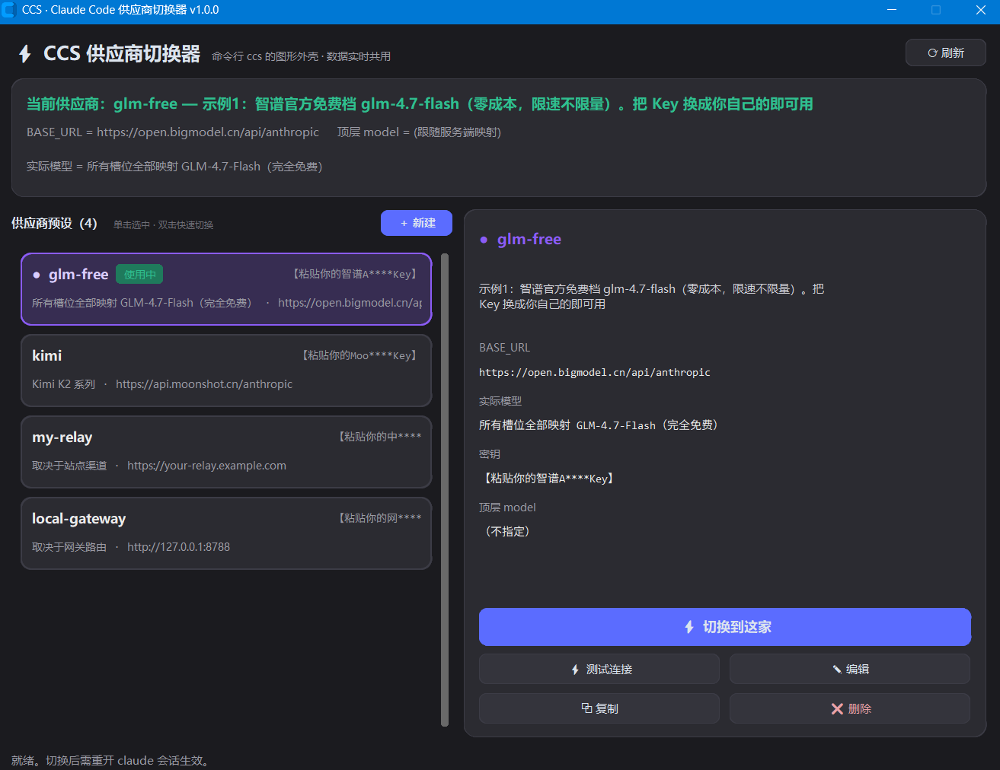

# ⚡ CCS Studio · Claude Code 供应商切换器

> 一键在多家 Claude Code 供应商之间切换 —— GUI 与 CLI 共用同一份配置，改完即走，互不干扰。
>
> **One-click provider switching for Claude Code. A GUI and a CLI sharing the exact same config.**

<!-- 截图占位：在此插入主界面截图

-->

---

## ✨ 特性

- 🖥 **GUI + CLI 双形态**：图形界面（卡片式、紫/绿双色状态标记）与命令行 `ccs` 操作**同一份** `~/.claude/providers.json`，随时混用，永不失同步
- 🎯 **配置指纹识别**：自动认出当前在用哪家供应商——即使多家预设共用同一个 BASE_URL 也不会混淆
- 🧹 **受管键统一清理**：切换时按"所有预设出现过的键的并集"统一清空再写入，上一家留下的模型映射、代理、超时设置**零残留**
- ⚡ **双击即切换**：卡片列表单击查看、双击切换；「测试连接」后台线程实测 `/v1/messages`（非流式 + 带思维链）
- 🔐 **密钥只在本地**：所有 Key 存于你自己的 `providers.json`，不经过任何第三方；`.gitignore` 内置防误提交
- 🛡 **数据安全三件套**：原子写入（断电不出半截文件）+ 每次修改前自动 `.bak` + 配置损坏时自动从备份恢复（无备份则保留 `.corrupt` 现场）
- 🧪 **实战打磨**：切换语义、unset 列表、超时参数均经多家真实供应商（官方端点 / 中转站 / 本机网关）长期验证

## 🎯 适用范围

**本工具专门服务 Claude Code**——命令行版与 IDE 插件版共用同一份配置，切换对两者同时生效：

| 工具 | 会被切换吗 |
|------|-----------|
| Claude Code 命令行版 | ✅ 主目标，每次新会话读取配置 |
| Claude Code IDE 插件（VS Code / JetBrains） | ✅ 底层是同一 CLI、同一份配置 |
| Claude Code 会话内的子 Agent / MCP | ✅ 继承环境变量，跟着走 |
| Codex CLI、ZCode 等其他 AI 工具 | ❌ 各有独立配置体系，不受影响 |

一句话：**改的是 `~/.claude/settings.json`，谁读它谁就被切**。

## 📦 安装

### 方式一：直接下载 exe（推荐小白）

到 [Releases](../../releases) 下载 `ccs-studio.exe`，双击即用（无需安装 Python）。

> 首次运行如被 SmartScreen 拦截：点「更多信息」→「仍要运行」。

### 方式二：Python 运行

```bash
pip install customtkinter
git clone https://github.com/<you>/ccs-studio.git
python ccs-studio/ccs_gui.pyw        # GUI
python ccs-studio/provider-switch.py list   # CLI
```

### 方式三：放进 Claude Code 目录常驻

```bash
cp ccs_gui.pyw ~/.claude/
cp provider-switch.py ~/.claude/
# 之后任意位置: pythonw ~/.claude/ccs_gui.pyw 启动 GUI
# 命令行入口按 ccs.cmd / ccs-gui.cmd 里的路径放进 PATH 即可
```

自己打包 exe：双击 `build-exe.cmd`（需先 `pip install pyinstaller`）。

## 🚀 使用

### 首次配置

```bash
cp providers.example.json ~/.claude/providers.json
# 然后编辑 ~/.claude/providers.json，把【粘贴你的…Key】换成真实 Key
```

预设格式（与 Claude Code 的 `settings.json` env 块一一对应）：

```jsonc
{
  "预设名": {
    "comment": "备注，随手写",
    "actual":  "实际跑什么模型，给未来的自己看",
    "set":     { "ANTHROPIC_BASE_URL": "...", "ANTHROPIC_AUTH_TOKEN": "...", "...": "要写入的环境变量" },
    "unset":   [ "切换走时要删掉的环境变量" ],
    "model":   null
  }
}
```

### GUI

| 操作 | 方式 |
|------|------|
| 查看供应商详情 | 单击卡片 |
| 一键切换 | 双击卡片，或选中后点「⚡ 切换到这家」 |
| 实测连通性 | 「⚡ 测试连接」（向该家发一个最小请求） |
| 新增供应商 | 「＋ 新建」，只填 5 个常用框即可，高级项折叠 |
| 编辑/复制/删除 | 右侧详情面板对应按钮 |

状态说明：🟣 紫色 = 正在查看；🟢 绿色「使用中」= 当前实际生效。切换后**重开 claude 会话**生效。

### CLI

```text
ccs list        查看所有供应商和当前状态
ccs now         确认当前在用哪家、实际跑什么模型
ccs <名称>      切换到指定供应商
```

## ⚙️ 工作原理（内核语义）

Claude Code 读哪个 API 完全由 `~/.claude/settings.json` 的 `env` 块决定。切换内核做四步：

1. **计算受管键** = 所有预设的 `set` + `unset` 键的并集 ∪ {`ANTHROPIC_API_KEY`, `ANTHROPIC_BASE_URL`, `ANTHROPIC_AUTH_TOKEN`} ∪ 代理三键
2. **统一清空**受管键（避免上家残留）
3. **写入**目标预设的 `set`，再剔除其 `unset` 列表
4. 处理顶层 `model` 字段后原子落盘

GUI 与 CLI 是同一内核的两个壳，数据只有一份。

## 🔐 安全须知

- **`providers.json` 含明文密钥**：它已被 `.gitignore` 排除，请勿截图、上传或分享
- 本工具只改写你本机的 `settings.json` / `providers.json`，不联网上传任何数据（「测试连接」的请求直接发往对应供应商）
- 请遵守目标服务的用户协议；因使用本工具产生的账号风险由使用者自担

## ❓ FAQ

<details>
<summary>提示 No module named 'customtkinter'</summary>

`pip install customtkinter`；或直接用 Release 里的 exe。
</details>

<details>
<summary>切换后没生效？</summary>

重开 claude 会话（环境变量在会话启动时读取）。会话内可用 `/status` 交叉确认。
</details>

<details>
<summary>Windows 之外能用吗？</summary>

核心逻辑纯 Python，macOS/Linux 把启动命令换成 `python3 ccs_gui.pyw` 即可；.cmd 启动器与桌面快捷方式为 Windows 特供。
</details>

<details>
<summary>配置文件坏了怎么办？</summary>

每次保存前都留有 `.bak`；程序检测到损坏会自动恢复，无备份时保留 `.corrupt` 现场供手工抢救。
</details>

## English (TL;DR)

**CCS Studio** is a GUI + CLI for switching Claude Code between multiple API providers (official endpoints, relays, local gateways). Built specifically for Claude Code — the CLI and the IDE plugin share one config file (`~/.claude/providers.json`), so both get switched at once. Switching = clear all managed env keys → write the target preset → remove its `unset` list → save atomically. Current provider is detected by config fingerprint, so same-URL presets never get confused. Keys never leave your machine.

```bash
pip install customtkinter && python ccs_gui.pyw
```

## License

[MIT](LICENSE)
